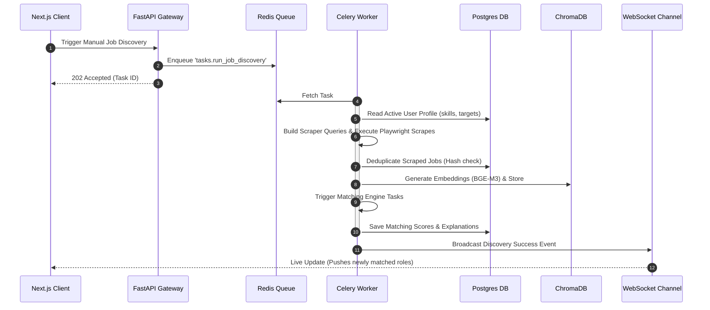
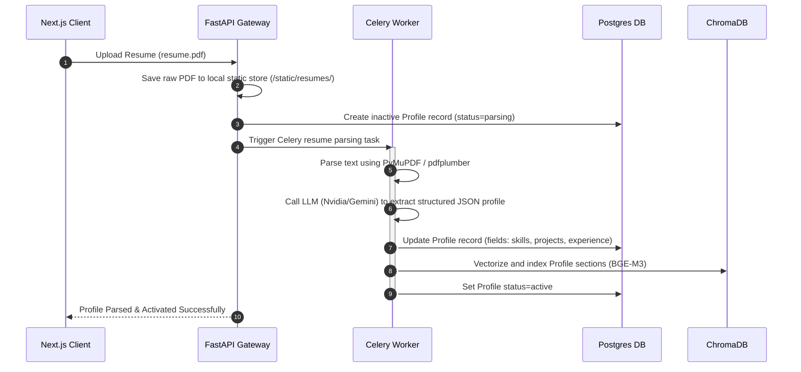

# 🏗️ System Architecture

This document provides a detailed breakdown of the system architecture, component interaction, and data-flow sequences of the **AI Career CoPilot** platform.

---

## 🏢 Multi-Tier Design

The platform is designed around a decoupled, event-driven multi-tier architecture:

```
+-------------------------------------------------------------+
|                     Next.js Client (UI)                     |
|           Dashboard | Kanban | Outreach | Settings          |
+------------------------------+------------------------------+
                               | REST APIs / WebSockets
+------------------------------v------------------------------+
|                    FastAPI (API Gateway)                    |
|           Endpoint Routing | Auth Checks | WS Channel       |
+------------------+-----------------------+------------------+
                   |                       |
                   | Enqueue               | Query / Persist
+------------------v--------------+        |
|      Celery Worker Queue        |        |
|  Scrape | Embed | Match | Email |        |
+------------------+--------------+        |
                   |                       |
+------------------v-----------------------v------------------+
|                        Storage Layer                        |
|   Postgres (Relational) | Chroma (Vector) | Redis (Cache)   |
+-------------------------------------------------------------+
```

1.  **Frontend Presentation Layer (Next.js 14)**: A TypeScript React client utilizing App Router conventions. It houses state via `Zustand` and handles query caching and server synchronizations via `TanStack Query`. It uses standard secure JWT mechanisms for authentication.
2.  **API Gateway Layer (FastAPI)**: Serves as the REST API gateway and WebSocket broadcaster. On startup, it boots the local SQLite or PostgreSQL tables and handles WebSocket connections under `/ws/jobs` and `/ws/tasks`.
3.  **Asynchronous Compute Workers (Celery & APScheduler)**: Processes scraping, vector generation, semantic search queries, and email drafting. Celery worker subprocesses spawn dynamic browser engines (Playwright) to fetch jobs off target listings.
4.  **Database Storage Layer**:
    *   **PostgreSQL**: Manages relations, application workflows, contact pipelines, and generated drafts.
    *   **ChromaDB**: Handles embeddings vector indexing for semantic similarity checks.
    *   **Redis**: Serves as the Celery broker, task result storage, and app cache.

---

## 🔌 Communication Protocols

*   **REST HTTP API**: Used for all client-initiated commands like profile uploads, manual job saves, contact creations, application state updates (Kanban column drags), and config modifications.
*   **WebSockets (`/ws/jobs` and `/ws/tasks`)**: Enables immediate real-time dashboard updates. When a background Celery task (like job scraping or ATS matching) completes, it broadcasts the results to all listening clients.
*   **AMQP/Redis Protocol**: Connects FastAPI and Celery workers, transporting task payloads and logs in real-time.

---

## 🔄 Core Sequences

### 1. Job Discovery & Processing Sequence

The job discovery workflow runs automatically via cron scheduling (`APScheduler`) or can be triggered manually by the user from the settings page.



### 2. Resume Parsing & Profile Activation Sequence


