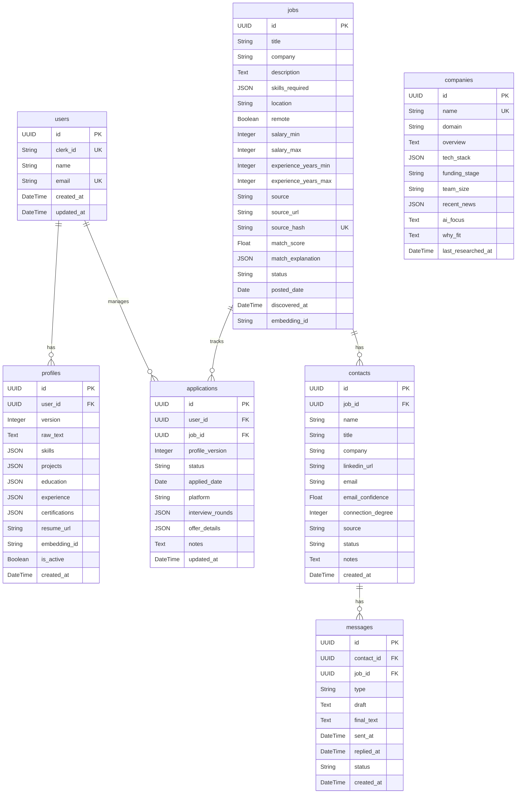

# 🗄️ Models & Database Schema

This document details the relational database schema, data validation contracts, and AI model configurations that form the backbone of the **AI Career CoPilot** platform.

---

## 📊 Relational Database Schema (SQLAlchemy / PostgreSQL)

All relational models are defined in `backend/app/models.py`.

### Table Details

#### 1. `users`
Stores user authentication profile data synchronizing with Clerk.
*   `id`: Primary key (UUID).
*   `clerk_id`: Unique Clerk identifier (Indexed).
*   `name`: User's display name.
*   `email`: User's verified email address (Indexed).

#### 2. `profiles`
Parsed resumes mapped to specific versions.
*   `user_id`: Foreign key referencing `users.id`.
*   `skills`: Map of skills categorized into `languages`, `frameworks`, and `tools`.
*   `projects`: List of project objects with name, tech stack, description, and impact metrics.
*   `is_active`: Boolean flag indicating if this is the active matching profile.

#### 3. `jobs`
Aggregated job postings discovered by scraper workers.
*   `source_hash`: SHA256 of `company_name + job_title + location` (Unique, Indexed).
*   `match_score`: Cosine similarity & overlap percentage score (0.0 to 100.0) (Indexed).
*   `status`: Discovery pipeline stage (`discovered`, `saved`, `applied`, `rejected`).

#### 4. `contacts`
Alumni or recruiter contacts found for a job.
*   `email_confidence`: Score from 0.0 to 1.0 indicating guessed email validity.
*   `status`: Outreach status (`discovered`, `pending_outreach`, `contacted`).

#### 5. `messages`
Generated LinkedIn & email outreach text.
*   `type`: Message classification (`linkedin_referral`, `cold_email`, `follow_up`).
*   `status`: Draft status (`draft`, `sent`, `replied`).

#### 6. `applications`
Active job tracking workflow entries.
*   `status`: Kanban pipeline step (`saved`, `applied`, `interviewing`, `offered`, `rejected`).
*   `interview_rounds`: JSON array tracking dates, interviewers, prep checklists, and results per round.

---

## 🔒 Data Validation (Pydantic v2)

API payload schema contracts are defined in `backend/app/schemas.py`.

*   **Pydantic strict typing**: Validates field definitions such as `EmailStr` for user creation and `UUID` identifiers.
*   **Attributes Serialization (`from_attributes = True`)**: Configured on responses to convert SQLAlchemy models into JSON payloads automatically.
*   **JSON Structures**: Structured maps (e.g. `skills: Optional[Dict[str, List[str]]]` and lists of key-value pairs) enforce field-level constraints.

---

## 🧠 AI / ML Models & Vector Databases

### 1. Large Language Models (LLMs)

The platform abstracts LLM interactions in `backend/app/services/llm.py`:

*   **Primary LLM: NVIDIA NIM (Llama 3.1 70B Instruct)**
    *   **Purpose**: Heavy-duty processing, including resume PDF schema extraction (generating structured JSON matching target profiles) and writing hyper-personalized outreach drafts.
    *   **Deployment**: Hosted as an optimized microservice (NVIDIA NIM inference endpoint).
*   **Fallback LLM: Google Gemini 2.0 Flash**
    *   **Purpose**: Lightweight structural updates, formatting, fast summary extraction, and serving as a fallback model during high latency or rate limits.
    *   **SDK**: `google-generativeai`

### 2. Embeddings & Semantic Similarity

*   **Model: BGE-M3 (via Sentence Transformers)**
    *   **Dimension**: 1024-dimensional dense vectors.
    *   **Purpose**: Generates high-quality semantic representations of job descriptions and structured resume components (such as project summaries and professional descriptions).
    *   **Local Execution**: Loaded into PyTorch context on the celery workers or backend APIs.

### 3. Vector Indexing Database

*   **ChromaDB**:
    *   **Storage**: Local persistent vector index database (`chroma_db` directory).
    *   **Collections**:
        *   `resumes`: Embeddings of resume segments and project accomplishments.
        *   `jobs`: Embeddings of scraped job description files.
    *   **Workflow**: When the matching service triggers, it pulls nearest neighbors for target job descriptions against the active profile sections using Cosine Similarity checks.
