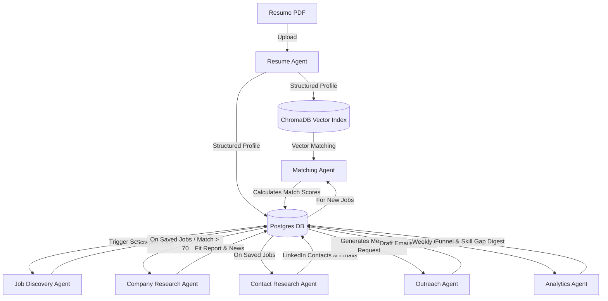

# 🤖 Workflows & Agentic Systems

This document details the background workflows, multi-agent collaborations, and matching engines powering the **AI Career CoPilot** platform.

---

## 👥 Multi-Agent Ecosystem

The platform uses 7 specialised, autonomous agents that coordinate via PostgreSQL states, Celery task queues, and vector database indexes.

### 1. Resume Agent
*   **Trigger**: File upload or Google Drive resume sync.
*   **Actions**:
    1. Parses PDF text using `PyMuPDF` and `pdfplumber`.
    2. Inputs raw text to NVIDIA NIM (Llama 3.1 70B) to parse into a structured JSON profile (education, projects, experience, skills).
    3. Serializes and indexes individual segments (projects, summary) as dense vectors in ChromaDB.
    4. Updates database, sets active version flag, and pushes notification: `"Resume parsed. 4 new projects mapped."`

### 2. Job Discovery Agent
*   **Trigger**: APScheduler Cron (every 4 hours) or manual dashboard trigger.
*   **Actions**:
    1. Analyzes active user profile to build search query strings (e.g. `"AI Engineer" Bangalore`, `"Python Developer" remote`).
    2. Runs dynamic scrapers via Playwright to crawl pages like Wellfound, YC Jobs, Naukri, and LinkedIn.
    3. Hashes company/title/location to prevent duplicates.
    4. Persists new jobs to Postgres and triggers matching tasks.

### 3. Matching Agent
*   **Trigger**: New job insertion or profile update.
*   **Actions**: Matches resume against the job description using the hybrid scoring engine and applies penalty metrics.

### 4. Company Research Agent
*   **Trigger**: Job status changed to `saved` or `match_score > 70`.
*   **Actions**:
    1. Fires search queries to fetch company funding status, stage, news, and stack.
    2. LLM creates a concise fit report explaining why the user's background aligns with the company's projects.

### 5. Contact Research Agent
*   **Trigger**: Job saved by user.
*   **Actions**:
    1. Crawls LinkedIn search results for engineering leads, recruiters, or alumni.
    2. Runs email permutations (e.g., `first.last@company.com`) through SMTP verification to find active mail addresses.

### 6. Outreach Agent
*   **Trigger**: User clicks "Draft Outreach".
*   **Actions**:
    1. Compiles profile projects, company fit reports, and contact info.
    2. Directs the LLM to write outreach drafts (LinkedIn referral requests or recruiter cold emails).
    3. Enforces length constraints (< 150 words for LinkedIn, < 200 for email) and excludes generic phrases.

### 7. Analytics Agent
*   **Trigger**: Weekly scheduler cron (Sunday 8 PM).
*   **Actions**:
    1. Computes application funnel stats (Saved -> Applied -> Interviewing -> Offered).
    2. Analyzes saved and rejected job listings to find frequently requested missing skills (e.g. "Kubernetes is requested in 6 JDs you lack").

---

## 🎯 The Matching Formula

The matching engine in `app/services/matching_service.py` evaluates candidate suitability using a weighted scoring model:

$$\text{Base Score} = (0.40 \times S) + (0.25 \times P) + (0.20 \times T) + (0.10 \times R) + (0.05 \times E)$$

Where:
*   **$S$ (Skills Overlap - 40%)**: The ratio of required job skills present in the user's profile:
    $$S = \frac{|\text{Profile Skills} \cap \text{Job Skills}|}{|\text{Job Skills}|}$$
*   **$P$ (Project Relevance - 25%)**: Cosine similarity between job description text and user projects:
    $$P = \max_{p \in \text{Projects}} (\text{CosineSimilarity}(p_{\text{text}}, \text{JD}_{\text{text}}))$$
*   **$T$ (Technology Stack Match - 20%)**: Match ratio of framework/tool definitions (mapped to core skill overlaps).
*   **$R$ (Role Title Similarity - 10%)**: Matching score based on job title focus (e.g., AI/ML, Android) against user project keywords (Gemini, Kotlin, etc.).
*   **$E$ (Education Match - 5%)**: Checks user education records for degrees in computer science or related fields.

### ⚠️ Penalties Applied
*   **Experience Gap Penalty**: If required experience exceeds user's experience:
    $$\text{Penalty} = -15 \text{ points}$$
*   **Location Mismatch Penalty**: If job is onsite and outside the user's supported locations:
    $$\text{Penalty} = -10 \text{ points}$$

---

## ⚙️ Asynchronous Background Queue (Celery & Redis)

Long-running tasks are handled off the main thread by Celery.

*   **Redis Broker**: Redis acts as the message broker (port `6389` in local development).
*   **Task Definitions**:
    *   `tasks.run_resume_parse(profile_id)`: Extracts resume text and structures it.
    *   `tasks.run_job_discovery()`: Scrapes job listings.
    *   `tasks.run_job_match(job_id, profile_id)`: Calculates match scores and calls NIM endpoints.
    *   `tasks.run_company_research(company_id)`: Web researches saved companies.
*   **Polling Loop**: APScheduler schedules periodic discovery calls and synchronizes tasks every 4 hours. WebSocket manager pushes execution notifications to the frontend.
